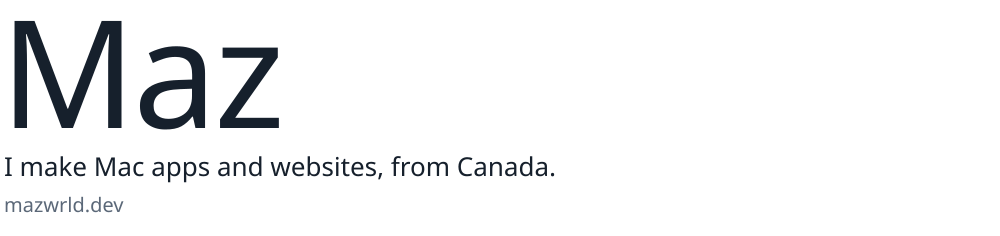
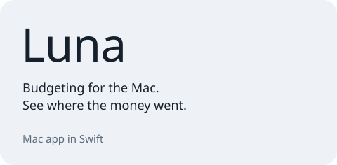
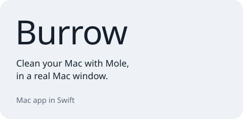
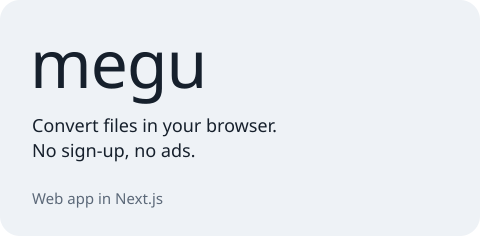
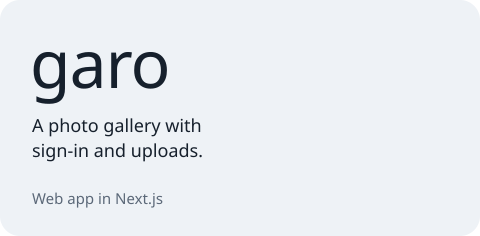
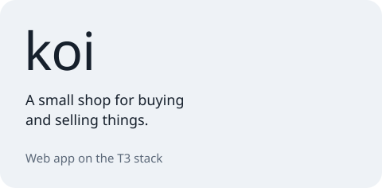
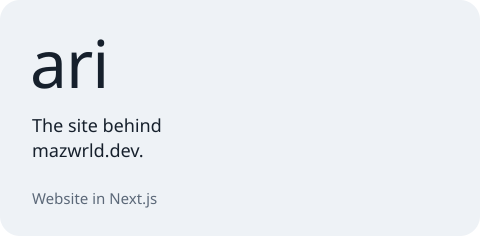

<a href="https://www.mazwrld.dev"><picture><source media="(prefers-color-scheme: dark)" srcset="intro-dark.svg"></picture></a>

<a href="https://github.com/mazwrld/luna-releases"><picture><source media="(prefers-color-scheme: dark)" srcset="work/luna-dark.svg"></picture></a>
<a href="https://github.com/mazwrld/Burrow"><picture><source media="(prefers-color-scheme: dark)" srcset="work/burrow-dark.svg"></picture></a>
<a href="https://github.com/mazwrld/megu"><picture><source media="(prefers-color-scheme: dark)" srcset="work/megu-dark.svg"></picture></a>
<a href="https://github.com/mazwrld/garo"><picture><source media="(prefers-color-scheme: dark)" srcset="work/garo-dark.svg"></picture></a>
<a href="https://github.com/mazwrld/koi"><picture><source media="(prefers-color-scheme: dark)" srcset="work/koi-dark.svg"></picture></a>
<a href="https://github.com/mazwrld/ari"><picture><source media="(prefers-color-scheme: dark)" srcset="work/ari-dark.svg"></picture></a>

